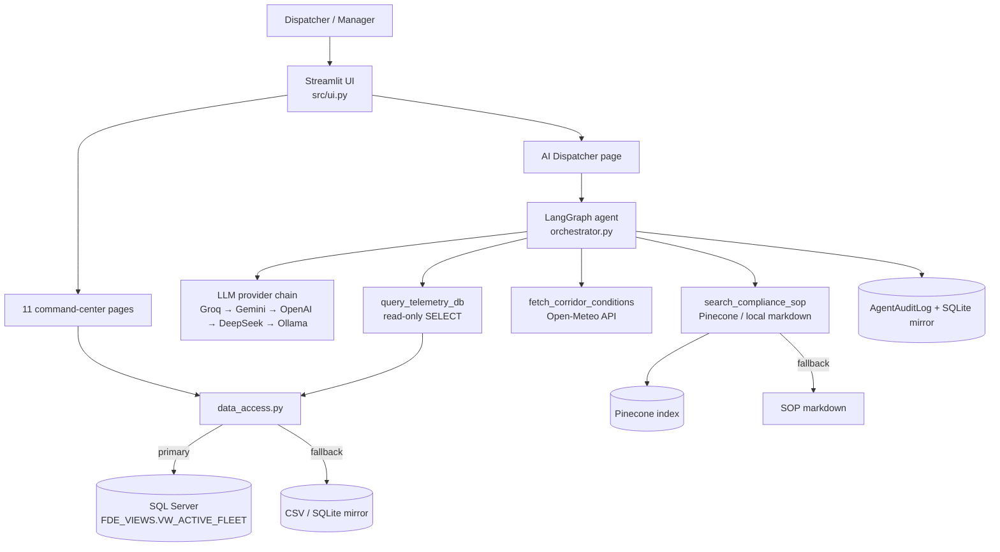

<div align="center">

# 🧊 FDE Intelligence
### AI-Powered Cold-Chain Loss Prevention Platform

**A decision-support platform that helps logistics operations teams spot shipment risk earlier, understand potential financial exposure, prioritise interventions, and keep a human in control of every operational action.**

[](https://www.python.org/)
[](https://streamlit.io/)
[](https://www.langchain.com/langgraph)
[](https://www.microsoft.com/sql-server)
[](https://www.pinecone.io/)
[]()

</div>

---

## How to read this README

This project is under active development. To keep the document honest, every capability is tagged:

| Tag | Meaning |
|---|---|
| ✅ **Implemented** | Exists in the repository today and can be run. |
| 🚧 **Planned** | Designed and scoped, but **not yet built**. No results are claimed for it. |

Data is also labelled by type throughout: **historical/static CSV**, **live API** (Open-Meteo weather only), **simulated**, and **estimated**. Nothing in this repository is a live sensor stream.

---

## Table of Contents

1. [Project Overview](#1-project-overview)
2. [The Business Problem](#2-the-business-problem)
3. [Target Users and Workflows](#3-target-users-and-workflows)
4. [Current Capabilities vs. Roadmap](#4-current-capabilities-vs-roadmap)
5. [Solution Architecture](#5-solution-architecture)
6. [Data Sources and Dataset Limitations](#6-data-sources-and-dataset-limitations)
7. [Data Engineering Workflow](#7-data-engineering-workflow)
8. [Machine Learning Methodology](#8-machine-learning-methodology)
9. [LangGraph Agent Architecture](#9-langgraph-agent-architecture)
10. [Financial Exposure Methodology](#10-financial-exposure-methodology)
11. [Human Approval Workflow](#11-human-approval-workflow)
12. [Security Model](#12-security-model)
13. [Installation and Configuration](#13-installation-and-configuration)
14. [Running the Platform](#14-running-the-platform)
15. [Deployment](#15-deployment)
16. [Business Impact Measurement](#16-business-impact-measurement)
17. [Why This Is a Forward Deployed Engineering Project](#why-this-is-a-forward-deployed-engineering-project)
18. [Project Structure](#17-project-structure)
19. [Limitations and Roadmap](#18-limitations-and-roadmap)
20. [References and Attribution](#19-references-and-attribution)
21. [Disclaimer and License](#20-disclaimer-and-license)

---

## 1. Project Overview

**FDE Intelligence** is a Streamlit command center fused with a LangGraph tool-calling AI Dispatcher. It combines shipment telemetry, cold-chain SOP retrieval, and live corridor weather so that a dispatcher (or an AI agent using the *same* governed tools) can investigate risk before it becomes loss.

The design principle: **the agent proposes, a human authorises.** The AI never executes operational actions on its own, never writes to the database, and never invents data.

The central question this project is built around:

> *Can a logistics operations team identify shipment risks earlier, understand the potential financial exposure, prioritise interventions, and then measure whether those interventions actually prevented losses?*

---

## 2. The Business Problem

### Industry context

India's post-harvest and cold-chain sector faces large, well-documented losses. According to FICCI–Grant Thornton research, as reported by Business Standard on 5 October 2026:

- Estimated annual post-harvest losses across 54 crops and commodities are around **₹1.5 trillion**.
- Estimated annual food losses across horticulture, dairy, meat, poultry and fish are **17–47 million tonnes**.
- Key gaps include farm-level packhouses, pre-cooling, refrigerated vehicles, and supply-chain traceability.

Source: [Business Standard, 5 Oct 2026](https://www.business-standard.com/industry/news/india-nears-cold-storage-goal-but-first-mile-gaps-remain-ficci-gt-bharat-126100500471_1.html)

> ⚠️ **These are industry-level estimates and are context only.** They are not attributed solely to temperature excursions, and they are **not** a baseline for this application's savings. This project does not claim to eliminate or reduce them.

### What a logistics operator typically cannot answer today

1. Which shipment is most likely to be delayed?
2. Which shipment is at risk of a temperature excursion?
3. Which shipments carry the greatest potential financial exposure?
4. Which route or corridor is becoming dangerous?
5. Which vehicle or operating condition needs attention?
6. Which shipments should receive intervention first?
7. Which SOP applies to a specific incident?
8. What should the dispatcher do first?
9. How much exposure could an intervention plausibly avoid?
10. Did the intervention actually improve the outcome?

### Traditional operations vs. FDE Intelligence

| Dimension | Traditional cold-chain operations | FDE Intelligence |
|---|---|---|
| Monitoring | Spreadsheet pulls and siloed carrier portals | One multipage command center over a unified fleet view |
| Excursion detection | Often discovered after delivery | Threshold checks against configurable cargo profiles ✅ |
| SOP lookup | Searching PDFs or phoning compliance | Semantic SOP search with a local markdown fallback ✅ |
| Root-cause analysis | Analyst manually joins logs, weather and routes | Agent chains telemetry → weather → SOP tools ✅ |
| Decision support | Tribal knowledge of senior dispatchers | Structured, tool-grounded briefings and downloadable reports ✅ |
| Audit trail | Emails and call logs | Agent audit log (SQL Server) with a local SQLite mirror ✅ |
| Resilience | Single points of failure | LLM provider chain and SQL → CSV / Pinecone → markdown fallbacks ✅ |
| Human role | Manual triage | Decision-maker and approver |

---

## 3. Target Users and Workflows

| Role | Typical question | Where in the platform |
|---|---|---|
| **Dispatcher** | "Which shipments need attention right now?" | Overview, Live Fleet, AI Dispatcher |
| **Operations manager** | "Where is exposure concentrated, and which interventions should I approve?" | Loss Prevention Center 🚧, Audit Center |
| **Compliance / quality** | "Which SOP applies to this excursion?" | Cold Chain, SOP Knowledge Base |
| **Administrator** | "Who did what, and with which model and data source?" | Audit Center, Settings |
| **Read-only viewer** | "What is the current fleet picture?" | Overview, Analytics |

Target workflow (the full loss-prevention loop, partially built — see the next section):

```text
Shipment identified → Risk detected → Evidence collected → Exposure estimated
→ SOP retrieved → Intervention recommended → Human approval
→ Action recorded → Outcome tracked
```

---

## 4. Current Capabilities vs. Roadmap

### ✅ Implemented today

| Area | What exists | Module |
|---|---|---|
| Streamlit shell | 11-page navigation using `st.navigation` | `src/ui.py`, `src/app_pages/` |
| Executive overview | KPI cards, temperature trends against SOP thresholds, alert feed, briefings | `overview.py` |
| Fleet map | PyDeck map, filters, record inspector with live-GPS weather lookup | `live_fleet.py` |
| Shipment analytics | Movement filters, delay-probability analytics (uses dataset columns), CSV export | `shipment_intel.py` |
| Cold-chain monitoring | Selectable cargo temperature profiles with source attribution and an `sop_verified` flag, excursion logging | `cold_chain.py`, `config.py` |
| Route and weather | Corridor comparisons, SOP §2 port-congestion diversion check, Open-Meteo live and 24h forecast | `route_intel.py`, `weather_intel.py` |
| AI Dispatcher | LangGraph agent, multi-session chat, tool trace viewer, Markdown report download, provider fallback | `ai_dispatcher.py`, `orchestrator.py` |
| Agent tools | `query_telemetry_db`, `fetch_corridor_conditions`, `search_compliance_sop` | `agent_tools.py` |
| SOP retrieval | Pinecone semantic search with local markdown fallback | `sop_kb.py`, `scripts/ingest_sop_pinecone.py` |
| Data layer | SQL Server with automatic CSV/SQLite fallback | `data_access.py` |
| Audit | `AgentAuditLog` (admin-gated) plus local SQLite audit cache | `audit_center.py` |
| Security basics | Read-only DB user, single-statement `SELECT` validation, secrets in `.env` | `agent_tools.py`, `setup_security_and_view.sql` |

### 🚧 Planned (not yet built)

| Area | Planned capability |
|---|---|
| Data engineering | Reproducible profile → validate → preprocess pipeline, data dictionary, quality report |
| Predictive ML | Delay and risk models with leakage controls and a published evaluation report |
| Loss-prevention engine | Transparent, configurable shipment prioritisation |
| Financial exposure | Calculator with configurable assumptions (see [§10](#10-financial-exposure-methodology)) |
| Incident workflow | Incident records, human approval, action status, outcome tracking |
| Additional agent tools | `predict_shipment_delay`, `calculate_financial_exposure`, `create_incident_record`, etc. |
| Enterprise security | Role-based access control (dispatcher / manager / admin / viewer), prompt-injection defences, rate limiting |
| ROI module | Business impact tracking per [§16](#16-business-impact-measurement) |
| Quality | Unit and integration test suite |

---

## 5. Solution Architecture



### Agent reasoning flow

```text
Dispatcher question
        │
        ▼
ai_dispatcher.py ──► orchestrator.py (LangGraph fde_agent)
                          │   system_prompt.txt enforces a structured response
        ┌─────────────────┼──────────────────┐
        ▼                 ▼                  ▼
query_telemetry_db  fetch_corridor_    search_compliance_sop
(read-only SQL)     conditions         (vector / local SOP)
        └─────────────────┼──────────────────┘
                          ▼
     Structured response + tool trace + Markdown report
                          ▼
            Audit log (SQL Server + SQLite mirror)
```

---

## 6. Data Sources and Dataset Limitations

### Sources

| Source | Type | Use |
|---|---|---|
| [Logistics and Supply Chain Dataset](https://www.kaggle.com/datasets/datasetengineer/logistics-and-supply-chain-dataset/data) (Kaggle, `datasetengineer`) | **Historical / static CSV** | Fleet telemetry, risk and delay fields |
| `data/policy/Cold_Chain_Incident_SOP_v2.md` | Static policy document | SOP retrieval |
| [Open-Meteo](https://open-meteo.com/) | **Live API** | Current conditions and 24h forecast |

### Observed dataset profile

Measured from the bundled file `data/raw/dynamic_supply_chain_logistics_dataset.csv`:

| Property | Value |
|---|---|
| Rows × columns | 32,065 × 26 |
| Time coverage | 2021-01-01 to 2024-08-29 (hourly) |
| Missing values | 0 |
| Duplicate rows | 0 |
| `risk_classification` distribution | High Risk 74.7%, Moderate Risk 15.6%, Low Risk 9.7% |
| GPS coverage | United States (latitudes up to 50°N, longitudes up to −70°) |
| `iot_temperature` | mean ≈ 0.04 °C, std ≈ 14.2 °C, maximum 40 °C |

### ⚠️ Critical limitations (read before interpreting any output)

- **Not Indian cold-chain data.** The GPS coordinates are in the United States. The ₹ industry context in [§2](#2-the-business-problem) is background only and is not derived from this dataset.
- **Not real-time telemetry.** The data is a static historical file. Hourly timestamps, no gaps, no missing values and no duplicates are consistent with a generated or simulated dataset. Confirm the collection methodology against the Kaggle page before presenting it as real operational data.
- **`iot_temperature` is not a realistic reefer-trailer signal.** A standard deviation of about 14 °C with values up to 40 °C does not resemble a controlled cold chain. Excursion results computed from it are **demonstration outputs**, not evidence about real cargo.
- **No shipment ID, vehicle ID, cargo type or shipment value columns** exist in the raw file. Any per-shipment identity or monetary value in the app is derived or simulated and must be labelled as such.
- **Potential target leakage.** `delay_probability`, `risk_classification`, `delivery_time_deviation` and `disruption_likelihood_score` look like derived or outcome fields. They must not be used as inputs when predicting each other. See [§8](#8-machine-learning-methodology).
- **Class imbalance.** About three quarters of records are labelled High Risk, so accuracy alone is a misleading metric.
- The SOP describes **Southern California** operations, while the dataset's coordinates span a wider US range.

The raw dataset's licence terms are set by its Kaggle page; check them before redistributing the file.

---

## 7. Data Engineering Workflow

### ✅ Existing ingestion

```bash
python scripts/ingest_legacy_data.py        # CSV → dbo.TBL_SC_FLEET_HIST_RAW (SQL Server)
python scripts/ingest_sop_pinecone.py       # SOP markdown → Pinecone index
# apply scripts/setup_security_and_view.sql  # creates FDE_VIEWS.VW_ACTIVE_FLEET and USR_FDE_RO
```

An ingestion hash cache (`data/cache/ingestion_hash_cache.json`) avoids re-loading unchanged files.

### 🚧 Planned reproducible pipeline

```text
Raw CSV → Validation → Cleaning → Feature engineering
        → Training → Evaluation → Model artifact → App inference
```

| Planned script | Purpose |
|---|---|
| `scripts/download_dataset.py` | Fetch via the Kaggle API |
| `scripts/profile_dataset.py` | Reproducible profiling report |
| `scripts/validate_data.py` | Schema, range and null checks |
| `scripts/preprocess_data.py` | Cleaning and feature engineering |
| `scripts/train_models.py` / `evaluate_models.py` | Training and evaluation |

Planned layout: `data/raw/` (untouched original), `data/processed/`, `data/external/`, `data/reports/`. Any synthetic demonstration data will live in a **separate, clearly labelled** dataset. Missing temperatures or losses are never manufactured and presented as real.

---

## 8. Machine Learning Methodology

> 🚧 **Status: not yet trained.** No performance metrics are published because no models have been evaluated. This section documents the intended method; results will be added only after real runs.

### Candidate targets (subject to data support)

| Target | Dataset column | Notes |
|---|---|---|
| Risk class | `risk_classification` | Check whether it is a deterministic function of other columns |
| Delay | `delay_probability` | Probabilistic score, not an observed delay flag; a binary label would need a justified threshold |
| Delivery deviation | `delivery_time_deviation` | Regression target |
| Temperature excursion | — | Only if suitable labels exist; the current temperature field is not a credible source |
| Financial exposure | — | No value or loss columns exist; cannot be modelled from this data |

### Methodology

- Stratified splits for classification; **time-based splits** (the data is hourly 2021–2024) for temporal prediction.
- Leakage audit before modelling; derived label columns excluded from the feature set.
- Baselines first (majority class, Logistic Regression), then Random Forest and gradient boosting (XGBoost / LightGBM if justified).
- Cross-validation and hyperparameter tuning on training data only.
- Imbalance handling (class weights, threshold tuning).
- **Metrics:** precision, recall, F1, ROC-AUC, PR-AUC, confusion matrix and calibration for classifiers; MAE and RMSE for regression. Recall on high-risk shipments is weighted above raw accuracy, because missing a risky shipment costs more than a false alarm.
- Explainability via feature importance and SHAP, plus model versioning with reproducible seeds.

### Results

| Model | Task | Metric | Result |
|---|---|---|---|
| — | — | — | *Not yet evaluated* |

---

## 9. LangGraph Agent Architecture

The agent (`src/orchestrator.py`) is a LangGraph `fde_agent` governed by `src/prompts/system_prompt.txt`.

### ✅ Current tools

| Tool | Data source | Guardrails |
|---|---|---|
| `query_telemetry_db(sql_query)` | SQL Server view or CSV mirror | Single-statement `SELECT` only; authenticates as read-only `USR_FDE_RO` |
| `fetch_corridor_conditions(latitude, longitude)` | Open-Meteo (live) | Read-only external call |
| `search_compliance_sop(query)` | Pinecone, or local SOP markdown | Read-only retrieval |

### LLM provider chain

Groq → Gemini → OpenAI → DeepSeek → local Ollama, selectable at runtime via `Agent_llm`, with an automatic fallback to Groq on `429` quota errors.

### 🚧 Planned tools

`predict_shipment_delay`, `calculate_shipment_risk`, `check_temperature_compliance`, `calculate_financial_exposure`, `create_incident_record`, `generate_dispatch_report`. A tool will be added only when it is backed by real code and data.

### Grounding rule

Answers must come from tool outputs. The agent must state uncertainty and missing data rather than inventing shipment records, sensor readings, financial figures or events.

---

## 10. Financial Exposure Methodology

> 🚧 **Status: planned.** The raw dataset contains no shipment value or loss columns (see [§6](#6-data-sources-and-dataset-limitations)), so the calculator will run on user-supplied or clearly simulated assumptions.

```text
Expected exposure  =  Shipment value × P(adverse event) × Loss severity
Avoidable exposure =  Expected exposure reduction from an intervention − Intervention cost
```

- All inputs are configurable and shown next to every result.
- **Expected exposure is a model-based estimate, never reported as actual loss.**
- "Actual realised loss" is shown only where a loss was recorded in an incident outcome.
- The platform will not claim savings without validated intervention and outcome records.

---

## 11. Human Approval Workflow

> 🚧 **Status: planned.** Today the AI Dispatcher produces advisory output only, and no operational action is executed.

Planned incident lifecycle, with these fields tracked per record: incident ID, shipment ID, risk category, evidence, recommendation, approver, approval timestamp, action status, outcome, and actual cost (if known).

```text
Recommended → Pending approval → Approved / Rejected → In progress → Completed → Outcome recorded
```

Where no external integration exists (for example, a carrier or ticketing system), the workflow **records and approves the proposed action** rather than pretending it was carried out.

---

## 12. Security Model

### ✅ In place

- Secrets live in `.env` or Streamlit Cloud Secrets and are never rendered in the UI; `.env` is git-ignored.
- The agent's SQL tool is limited to single-statement `SELECT` queries and uses the read-only `USR_FDE_RO` account.
- The Audit Center requires separate administrator credentials.
- Outputs are decision support; operational actions require human authorisation.
- Layered fallbacks (SQL → CSV, Pinecone → markdown, provider chain) avoid single points of failure.

### 🚧 Planned

- Role-based access control: dispatcher, operations manager, administrator, read-only viewer.
- Parameterised queries throughout and stricter input validation.
- Prompt-injection defences and explicit tool permission boundaries.
- Rate limiting and configuration validation.
- A guarantee that the agent cannot approve high-impact actions.

---

## 13. Installation and Configuration

```bash
git clone https://github.com/akashtcaa2005/FDE-Project---AI-Powered-Cold-Chain-Logistics-Intelligence-Platform.git
cd FDE-Project---AI-Powered-Cold-Chain-Logistics-Intelligence-Platform

python3 -m venv .venv
source .venv/bin/activate        # Windows: .venv\Scripts\activate
pip install -r requirements.txt
cp .env.example .env
```

Optional, only for a live SQL Server connection (Ubuntu):

```bash
sudo apt-get update
sudo ACCEPT_EULA=Y apt-get install -y msodbcsql18 unixodbc-dev
```

### Environment variables

Never commit `.env`.

| Variable | Default / options | Description |
|---|---|---|
| `Agent_llm` | `GROQ` if a key is set, else `OLLAMA` | Provider: `GROQ`, `GEMINI`, `OPENAI`, `DEEPSEEK`, `OLLAMA` |
| `GROQ_API_KEY` / `GROQ_MODEL` | `openai/gpt-oss-120b` | Groq (also the `429` fallback) |
| `GEMINI_API_KEY` / `GEMINI_MODEL` | see `.env.example` | Google Gemini |
| `OPENAI_API_KEY` / `OPENAI_MODEL` | see `.env.example` | OpenAI |
| `DEEPSEEK_API_KEY` / `DEEPSEEK_MODEL` | see `.env.example` | DeepSeek |
| `OLLAMA_MODEL` | `qwen2.5:7b` | Local Ollama model |
| `PINECONE_API_KEY` | — | If unset, SOP search uses `data/policy/` |
| `Embeddings_model` | `LOCAL` (`LOCAL` or `OPENAI`) | Embedding backend |
| `Local_Embedding_Model` | `BAAI/bge-m3` | Hugging Face embedding model |
| `SQL_SERVER_HOST` / `SQL_SERVER_PORT` | `localhost` / `1433` | Falls back to the CSV mirror if unreachable |
| `SQL_AGENT_USER` / `SQL_AGENT_PASSWORD` | `USR_FDE_RO` | Read-only telemetry credentials |
| `SQL_ADMIN_USER` / `SQL_ADMIN_PASSWORD` | — | Audit Center and ingestion only |

### Dataset setup

The app runs **zero-config**: with no SQL Server or Pinecone, it uses the bundled CSV and local SOP markdown. The dataset source link is stored in `data/source/data.txt`.

For the full enterprise stack, a local SQL Server can be started with Docker (use your own strong password and never commit it):

```bash
docker run -e "ACCEPT_EULA=Y" -e "MSSQL_SA_PASSWORD=<YOUR_STRONG_PASSWORD>" \
  -p 1433:1433 --name legacy-mssql -d mcr.microsoft.com/mssql/server:2022-latest
python scripts/ingest_legacy_data.py
```

Then apply `scripts/setup_security_and_view.sql` and run `python scripts/ingest_sop_pinecone.py`. Additional notes are in `docs/instrutions.md`.

---

## 14. Running the Platform

```bash
streamlit run src/ui.py
```

Open `http://localhost:8501`. To verify components from the command line:

```bash
python src/agent_tools.py
python src/orchestrator.py
```

### Example dispatcher questions

- "Which shipments have the highest delay probability?"
- "Is the corridor weather around this vehicle likely to affect delivery?"
- "Which SOP applies to a temperature above 4 °C?"
- "Generate an executive briefing of the highest-risk records."

> Questions about financial exposure, incident approval and named shipment IDs (for example `SH-1001`) depend on 🚧 planned features and on identifiers the raw dataset does not contain.

### Screenshots

> *Add screenshots of the Overview, Live Fleet, Cold Chain and AI Dispatcher pages here, for example `docs/images/overview.png`.*

---

## 15. Deployment

**Streamlit Community Cloud**

1. Push the repository to GitHub and open [share.streamlit.io/deploy](https://share.streamlit.io/deploy).
2. Repository: `akashtcaa2005/FDE-Project---AI-Powered-Cold-Chain-Logistics-Intelligence-Platform`, branch `main`, main file `src/ui.py`.
3. Under **Advanced settings → Secrets**, add TOML:

```toml
Agent_llm = "GROQ"
GROQ_API_KEY = "your-groq-key"
PINECONE_API_KEY = "your-pinecone-key"
Embeddings_model = "LOCAL"
Local_Embedding_Model = "BAAI/bge-m3"
```

Community Cloud has no route to a private SQL Server, so a cloud deployment normally runs in **CSV fallback mode**. Note that `torch` and `sentence-transformers` are large dependencies; use `OPENAI` embeddings or a smaller model if memory is constrained.

---

## 16. Business Impact Measurement

> 🚧 **Status: planned.** No business impact is claimed today. There has been no pilot, no baseline, and no measured intervention outcomes.

The ROI module will keep five categories strictly separate:

| Category | Example | Can be presented as |
|---|---|---|
| Observed historical metrics | Count of records above a threshold | Fact about the dataset |
| Model predictions | Predicted delay probability | A prediction with uncertainty |
| Estimated financial exposure | Value × probability × severity | An estimate, not a loss |
| Simulated demonstrations | Synthetic sensor scenarios | Demo only |
| Verified business outcomes | Recorded intervention with a measured result | Evidence, only with outcome records |

Planned measures: shipments investigated, high-risk shipments identified, incidents detected, time from detection to human decision, interventions recommended / approved / completed, recorded actual losses, and verified avoidable loss where outcome evidence exists.

A percentage reduction in losses will be reported only after a real pilot against a reliable baseline.

---

## Why This Is a Forward Deployed Engineering Project

A Forward Deployed Engineer is embedded with a customer, understands the operational problem, works with the data that actually exists, and ships something the business can use and trust. This project is built to demonstrate that:

| FDE skill | How the project shows it |
|---|---|
| **Understanding a real business problem** | Framed around cold-chain loss prevention, with industry evidence kept separate from the application's own claims |
| **Working with imperfect data** | Documents dataset limits openly: US-only geography, a non-realistic temperature signal, no shipment IDs or values, leakage risks |
| **Building data pipelines** | CSV → SQL Server ingestion with hash caching; SOP → vector index; a reproducible validation and preprocessing pipeline is planned |
| **Integrating APIs and databases** | SQL Server (SQLAlchemy / pyodbc), Open-Meteo, Pinecone, and multiple LLM APIs |
| **Deploying ML models** | 🚧 Planned, with leakage controls and honest evaluation |
| **Agentic AI workflows** | LangGraph agent with three governed tools and a visible execution trace |
| **AI inside human workflows** | Advisory-only outputs; a human-approval incident lifecycle is planned |
| **Enterprise security and governance** | Read-only DB user, `SELECT`-only validation, admin-gated audit log; RBAC planned |
| **Measuring business outcomes** | Impact methodology that separates estimates from verified outcomes |
| **Adaptable to customer environments** | Config-driven cargo profiles, SQL ↔ CSV and Pinecone ↔ markdown fallbacks, swappable LLM providers |

---

## 17. Project Structure

```text
.
├── data/
│   ├── raw/        Bundled CSV (offline fallback)
│   ├── source/     Dataset source link
│   ├── policy/     SOP markdown (Pinecone fallback)
│   └── cache/      SQLite audit mirror, ingestion hash cache
├── docs/           Setup notes
├── Misc/Materials/ Business presentation and Technical Design Document (PDF)
├── scripts/
│   ├── ingest_legacy_data.py
│   ├── ingest_sop_pinecone.py
│   └── setup_security_and_view.sql
├── src/
│   ├── ui.py                 Streamlit entry point
│   ├── app_pages/            11 pages
│   ├── components/shell.py   Shared UI shell
│   ├── prompts/              Agent system prompt
│   ├── config.py             Paths, cargo profiles, corridor metadata
│   ├── data_access.py        SQL Server / CSV, weather, Pinecone, audit
│   ├── analytics.py          KPIs, alerts, briefings, reports
│   ├── charts.py             Altair and PyDeck visuals
│   ├── orchestrator.py       LangGraph agent
│   └── agent_tools.py        Agent tools
├── requirements.txt
└── .env.example
```

---

## 18. Limitations and Roadmap

### Known limitations

- The dataset is historical and appears synthetic; it is not live telemetry and not Indian cold-chain data.
- The only live external feed is weather (Open-Meteo).
- No ML models, financial exposure engine, incident workflow, RBAC or automated tests exist yet.
- The agent's `SELECT` validation is a guardrail, not a full defence against prompt injection.
- LLM outputs can be wrong and must be reviewed by a human.

### Roadmap

- [ ] Dataset profiling, validation and preprocessing scripts, with a data dictionary and quality report
- [ ] Leakage-safe delay and risk models with a published evaluation report
- [ ] Configurable cargo profiles with sourced thresholds (extend `config.py`)
- [ ] Transparent shipment prioritisation and financial exposure calculator
- [ ] Incident records with human approval, action status and outcome tracking
- [ ] Role-based access control and prompt-injection hardening
- [ ] Additional agent tools backed by real code
- [ ] Unit and integration tests, plus CI
- [ ] Business Impact / ROI module
- [ ] Connectors for ticketing and alerting (Jira / ServiceNow, Slack / Teams)

---

## 19. References and Attribution

- FICCI–Grant Thornton research as reported by Business Standard, 5 October 2026: [India nears cold storage goal, but first-mile gaps remain](https://www.business-standard.com/industry/news/india-nears-cold-storage-goal-but-first-mile-gaps-remain-ficci-gt-bharat-126100500471_1.html)
- Dataset: [Logistics and Supply Chain Dataset](https://www.kaggle.com/datasets/datasetengineer/logistics-and-supply-chain-dataset/data) by `datasetengineer` on Kaggle. Refer to the dataset page for its licence and collection description.
- Weather data: [Open-Meteo](https://open-meteo.com/)
- Built with Streamlit, LangGraph / LangChain, Pinecone, SQLAlchemy, pandas, scikit-learn, Altair and PyDeck.

---

## 20. Disclaimer and License

FDE Intelligence is an operational decision-support tool. Risk scores, briefings and recommendations are advisory and must be reviewed by a qualified person before any action is taken. It does not replace regulatory compliance processes, cold-chain certification, or professional logistics judgment.

**License:** not yet specified. Add a `LICENSE` file (for example MIT or Apache-2.0) before wider distribution.
