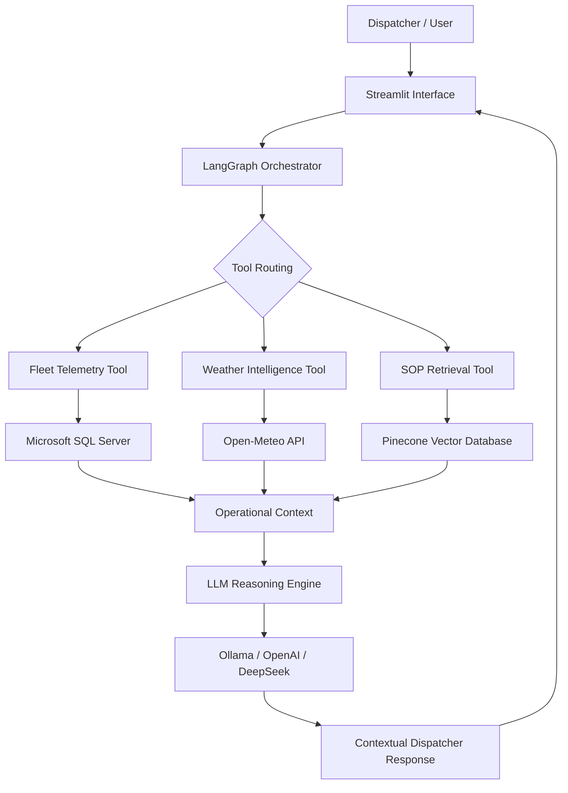

# ❄️ FDE — AI-Powered Cold Chain Logistics Intelligence Platform

### Intelligent Dispatch • Real-Time Fleet Intelligence • Operational Risk Analysis • AI-Powered Decision Support

<p align="center">
  <strong>An AI-powered logistics intelligence platform that transforms fragmented fleet telemetry, weather conditions, and operational policies into actionable dispatch decisions.</strong>
</p>

<p align="center">
  
  
  
  
  
</p>

<p align="center">
  
  
  
</p>

---

## 📌 Overview

Cold-chain logistics requires continuous coordination between fleet operations, transportation conditions, environmental risks, and temperature-sensitive supply-chain policies.

Traditional dispatch workflows often involve disconnected data sources, manual database queries, fragmented operational documentation, and delayed decision-making.

**FDE (Forward Deployed Engineering) — AI-Powered Cold Chain Logistics Intelligence Platform** addresses this challenge through an intelligent, tool-enabled AI dispatcher.

The platform integrates:

- Microsoft SQL Server for fleet telemetry and operational data.
- LangGraph for stateful AI agent orchestration.
- Pinecone for semantic retrieval of Standard Operating Procedures (SOPs).
- Open-Meteo for live weather and corridor-risk information.
- Local and cloud-based language models for natural-language reasoning.
- Streamlit for an interactive dispatcher interface and audit visibility.

Instead of manually navigating multiple systems, dispatchers can interact with a natural-language assistant that retrieves relevant operational information, invokes specialized tools, and generates context-aware responses.

> **Core Vision:** Build an intelligent logistics decision-support system that connects enterprise data, external intelligence, and organizational knowledge through an orchestrated AI agent.

---

## 🎯 The Problem

Cold-chain logistics operations face several interconnected challenges:

| Operational Challenge | Platform Capability |
|---|---|
| Fragmented fleet information | SQL-based fleet telemetry retrieval |
| Manual operational data analysis | Natural-language database interaction |
| Weather-related transportation risks | Live corridor weather intelligence |
| Difficult SOP and policy discovery | Semantic document retrieval |
| Slow dispatcher decision-making | Multi-tool AI orchestration |
| Limited operational traceability | Streamlit audit-log interface |

The objective is to reduce information fragmentation and provide dispatchers with a unified operational intelligence interface.

---

## 🚀 Key Features

### 1. Natural-Language Dispatcher Console

An interactive Streamlit interface that allows dispatchers to ask operational questions using natural language.

Example queries:

- Which fleet vehicles are currently active?
- Identify vehicles with potential operational risks.
- What are the relevant SOPs for a cold-chain incident?
- What weather conditions affect a transportation corridor?
- Retrieve operational information for a particular vehicle.

The AI agent determines which tools are required to answer a query.

### 2. Intelligent Fleet Telemetry Retrieval

Integrates Microsoft SQL Server with a restricted, read-only agent access layer.

Capabilities:

- Retrieve fleet telemetry.
- Query approved operational views.
- Access vehicle-related information.
- Support structured operational data retrieval.
- Maintain separation between administrative database access and agent-level access.

**Database:** Microsoft SQL Server

**Integration:** SQLAlchemy + pyodbc

### 3. Real-Time Weather & Corridor Intelligence

Connects to the Open-Meteo API to retrieve weather information relevant to transportation corridors.

Capabilities:

- Weather condition retrieval.
- Corridor-level environmental context.
- Weather-related operational risk assessment.
- Contextual weather information for dispatch decisions.

### 4. RAG-Powered SOP Intelligence

Uses Retrieval-Augmented Generation (RAG) to connect organizational knowledge with AI reasoning.

**Technology:** Pinecone + Embeddings + LangChain

Capabilities:

- Semantic search over SOP documents.
- Retrieve relevant cold-chain policies.
- Search incident response documentation.
- Provide policy context to the AI dispatcher.
- Ground responses in retrieved operational knowledge.

### 5. LangGraph Agent Orchestration

The platform uses LangGraph to coordinate the AI dispatcher and its specialized tools.

The orchestration layer handles:

- User query processing.
- Tool selection and routing.
- Tool execution.
- Retrieval of operational context.
- Response generation.

This enables the agent to combine structured database information, external weather information, and unstructured policy knowledge.

### 6. Flexible LLM Inference

Supports multiple reasoning configurations.

| Provider | Mode | Purpose |
|---|---|---|
| Ollama | Local | Run language models locally |
| OpenAI | Cloud | API-based reasoning |
| DeepSeek | Cloud | API-compatible reasoning |

The selected model provider is controlled through environment configuration.

### 7. Flexible Embedding Backends

Supports local Hugging Face embeddings and OpenAI embeddings.

Example local embedding model:

`BAAI/bge-m3`

This provides flexibility between local embedding generation and cloud-based embedding services.

### 8. Operational Audit Visibility

The Streamlit interface includes an audit-log experience for inspecting operational interactions.

It helps make dispatcher interactions and agent activity more transparent.

---

## 🏗️ System Architecture

The platform follows a modular, tool-oriented AI architecture.



### Architecture Components

| Component | Responsibility |
|---|---|
| Streamlit UI | Dispatcher interaction and audit visibility |
| LangGraph | Agent orchestration and tool routing |
| Agent Tools | Database, weather, and retrieval integrations |
| SQL Server | Structured fleet and operational data |
| Open-Meteo | External weather information |
| Pinecone | SOP and policy vector retrieval |
| Embedding Models | Convert documents and queries into vectors |
| LLM | Reasoning and response generation |

---

## 🧠 How It Works

The system follows a tool-assisted operational intelligence workflow.

**Step 1 — User Interaction**

The dispatcher submits a natural-language query through the Streamlit interface.

**Step 2 — Agent Orchestration**

LangGraph receives the query and coordinates the next action.

**Step 3 — Tool Selection**

The agent selects the appropriate tool based on the information required.

**Step 4 — Information Retrieval**

The selected tools retrieve information from:

- Microsoft SQL Server.
- Open-Meteo.
- Pinecone.

**Step 5 — Contextual Reasoning**

The retrieved information is passed into the configured language model for response generation.

**Step 6 — Dispatcher Response**

The application presents the generated operational response through the Streamlit interface.

---

## 🛠️ Technology Stack

| Category | Technologies |
|---|---|
| Programming Language | Python 3.12 |
| Frontend | Streamlit |
| Agent Framework | LangGraph |
| LLM Integration | LangChain |
| Database | Microsoft SQL Server |
| Database Connectivity | SQLAlchemy, pyodbc |
| Vector Database | Pinecone |
| Embeddings | Hugging Face, OpenAI |
| Local Inference | Ollama |
| Cloud Inference | OpenAI, DeepSeek |
| Weather Intelligence | Open-Meteo API |
| Environment Management | Python Virtual Environment, dotenv |
| Version Control | Git, GitHub |

---

## 📂 Project Structure

```text
FDE-Project---AI-Powered-Cold-Chain-Logistics-Intelligence-Platform/
│
├── .github/
│   └── workflows/
│       └── deploy.yml
│
├── .streamlit/
│   └── config.toml
│
├── data/
│   ├── raw/
│   │   └── dynamic_supply_chain_logistics_dataset.csv
│   │
│   ├── policy/
│   │   └── Cold_Chain_Incident_SOP_v2.md
│   │
│   └── cache/
│       └── ingestion_hash_cache.json
│
├── docs/
│   └── instrutions.md
│
├── Misc/
│   └── Materials/
│
├── scripts/
│   ├── ingest_legacy_data.py
│   ├── ingest_sop_pinecone.py
│   └── setup_security_and_view.sql
│
├── src/
│   ├── agent_tools.py
│   ├── orchestrator.py
│   ├── ui.py
│   └── prompts/
│       └── system_prompt.txt
│
├── .env.example
├── .gitignore
├── requirements.txt
└── README.md
```

*The structure above describes the intended project organization. Keep filenames consistent with the actual repository.*

---

## ⚙️ Installation & Setup

### Prerequisites

Install the following before running the application:

- Python 3.12
- Git
- Microsoft SQL Server
- Microsoft ODBC Driver 18 for SQL Server
- Pinecone account and API key
- Ollama for local inference, if selected

### 1. Clone the Repository

```bash
git clone https://github.com/akashtcaa2005/FDE-Project---AI-Powered-Cold-Chain-Logistics-Intelligence-Platform.git

cd FDE-Project---AI-Powered-Cold-Chain-Logistics-Intelligence-Platform
```

### 2. Create a Virtual Environment

```bash
python3 -m venv .venv

source .venv/bin/activate
```

### 3. Install Dependencies

```bash
pip install --upgrade pip

pip install -r requirements.txt
```

### 4. Install Microsoft ODBC Driver 18

For Ubuntu-based Linux distributions:

```bash
sudo apt-get update

sudo ACCEPT_EULA=Y apt-get install -y msodbcsql18 unixodbc-dev
```

For Kali Linux or other distributions, follow Microsoft's official installation instructions for the appropriate distribution.

### 5. Configure Environment Variables

Create a local environment file:

```bash
cp .env.example .env
```

Update `.env` with your own configuration.

Example configuration:

```dotenv
# Agent Configuration
Agent_llm=OLLAMA

# Embedding Configuration
Embeddings_model=LOCAL
Local_Embedding_Model=BAAI/bge-m3

# Pinecone
PINECONE_API_KEY=your_pinecone_api_key

# SQL Server
SQL_SERVER_HOST=localhost
SQL_SERVER_PORT=1433
SQL_DATABASE=your_database

# Database Administrator
SQL_ADMIN_USER=your_admin_username
SQL_ADMIN_PASSWORD=your_admin_password

# Restricted Agent Account
SQL_AGENT_USER=your_agent_username
SQL_AGENT_PASSWORD=your_agent_password
```

**Important:** Use the exact environment variable names expected by the application code. The configuration above is a template, not a guarantee that every variable is currently consumed by the application.

For cloud inference, configure the relevant provider:

```dotenv
Agent_llm=OPENAI
OPENAI_API_KEY=your_openai_api_key
```

Or:

```dotenv
Agent_llm=DEEPSEEK
DEEPSEEK_API_KEY=your_deepseek_api_key
```

Never commit `.env` or publish real credentials.

---

## 🗄️ Database & Data Ingestion

### Step 1 — Prepare SQL Server

Start a Microsoft SQL Server instance and configure its connection details through environment variables.

### Step 2 — Ingest Fleet Dataset

Run:

```bash
python scripts/ingest_legacy_data.py
```

This script is intended to ingest the legacy fleet dataset into the configured database.

### Step 3 — Configure Database Security

Apply:

```text
scripts/setup_security_and_view.sql
```

The SQL setup script is intended to establish a restricted agent access layer.

The agent should use approved read-only views rather than unrestricted administrative database access.

### Step 4 — Ingest SOP Documents

Configure your Pinecone index and run:

```bash
python scripts/ingest_sop_pinecone.py
```

This prepares the SOP and incident policy content for semantic retrieval.

---

## ▶️ Running the Application

Start the Streamlit application:

```bash
streamlit run src/ui.py
```

Open the local application:

```text
http://localhost:8501
```

### Optional Component Testing

```bash
python src/agent_tools.py
```

```bash
python src/orchestrator.py
```

These commands can be used for direct component execution where supported by the application code.

---

## 🔐 Security Architecture & Best Practices

Security is an important consideration when connecting AI agents to enterprise operational systems.

The platform is designed around the following principles:

### Database Access Isolation

- Separate administrator and agent database accounts.
- Restrict agent access to approved views.
- Use read-only database permissions for telemetry queries.
- Avoid exposing unrestricted SQL access to the language model.

### Credential Management

- Store credentials in local environment variables.
- Exclude `.env` from version control.
- Maintain `.env.example` with placeholders.
- Never hard-code API keys or database passwords.
- Rotate credentials that were previously committed.

### AI Agent Safety

- Restrict available tools to approved operations.
- Validate tool inputs.
- Avoid unrestricted database operations.
- Treat retrieved documents and external content as untrusted input.
- Validate AI-generated operational recommendations before execution.

### Deployment Security

- Store deployment credentials in GitHub Actions Secrets.
- Protect database credentials and API tokens.
- Avoid exposing sensitive configuration in application logs.
- Apply least-privilege access controls.

---

## 🌍 Potential Applications

The platform's architecture can support several cold-chain operational scenarios:

| Scenario | Intelligence Capability |
|---|---|
| Fleet monitoring | Retrieve vehicle telemetry |
| Weather-aware dispatch | Incorporate external weather conditions |
| Incident response | Retrieve relevant SOP documentation |
| Operational investigation | Combine fleet data and policy context |
| Dispatcher assistance | Natural-language operational queries |
| Risk awareness | Contextualize transportation conditions |

These are intended application scenarios; actual capabilities depend on the implemented data and tools.

---

## 🔮 Future Roadmap

Potential future enhancements include:

- [ ] Real-time IoT temperature and humidity monitoring.
- [ ] GPS-based live fleet tracking.
- [ ] Predictive cold-chain temperature excursion detection.
- [ ] ML-based vehicle and shipment risk scoring.
- [ ] Route optimization using operational constraints.
- [ ] Automated incident detection and alerting.
- [ ] Multi-agent architecture for specialized logistics workflows.
- [ ] Advanced operational analytics dashboard.
- [ ] Role-based access control and enhanced audit trails.
- [ ] Containerized deployment using Docker.
- [ ] Production observability and agent evaluation.
- [ ] Automated testing and CI/CD improvements.

---

## 👨‍💻 Project Information

**Project Name:** FDE — AI-Powered Cold Chain Logistics Intelligence Platform

**Domain:** Artificial Intelligence | Agentic AI | Supply Chain | Logistics Intelligence

**Primary Focus:** AI-powered operational decision support for cold-chain logistics.

**Developer:** Akash T

**GitHub:** [@akashtcaa2005](https://github.com/akashtcaa2005)

---

## 🤝 Contributing

Contributions, suggestions, and improvements are welcome.

1. Fork the repository.
2. Create a feature branch.
3. Implement your changes.
4. Test the changes.
5. Submit a pull request with a clear description.

Please do not submit credentials, private datasets, or confidential operational information.

---

## 📜 License

A license has not yet been specified.

Please contact the repository owner before reusing or redistributing this project until a license is added.

---

<p align="center">
  <strong>Built with Python, Agentic AI, Enterprise Data Integration, and Logistics Intelligence.</strong>
</p>

<p align="center">
  <em>Turning fragmented logistics information into intelligent operational decisions.</em>
</p>
