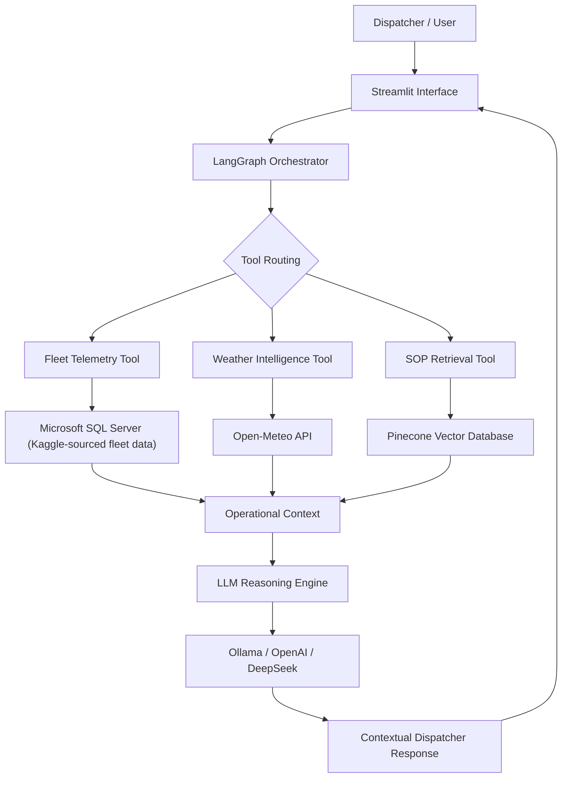

# ❄️ FDE — AI-Powered Cold Chain Logistics Intelligence Platform

### From Spreadsheets & Phone Calls to a Single AI Dispatcher — Built by Akash T

<p align="center">
  
  
  
  
  
</p>

<p align="center">
  
  
  
</p>

---

## 👋 For the Hiring Manager / HR Reviewer — Read This First

This project is my answer to a real, expensive problem in logistics: **dispatchers lose time and money because fleet data, weather risk, and company policy all live in different places.**

I built an AI agent that sits on top of all three and answers questions in plain English — the kind of thing a $50,000/year enterprise software contract usually does. I built it solo, end-to-end: database design, AI orchestration, retrieval systems, and a working interface.

**Why this should matter to you as a hiring decision:**
- I can take a vague business pain point and turn it into a working, demoable product — not just a script.
- I work with the same tools (LangGraph, vector databases, SQL, cloud + local LLMs) that production AI teams use today.
- I write documentation like this — clearly, for both technical and non-technical readers — because I understand that software only creates value when people can actually understand and trust it.
- I test ideas against real-world data (see the Kaggle dataset section below) instead of toy examples.

If you're scanning resumes, the short version is: **I don't just study AI. I ship it.**

---

## 🧭 The Business Problem, In Plain Terms

Imagine a mid-size cold-chain logistics company — refrigerated trucks moving vaccines, dairy, or seafood across a region.

### How dispatch traditionally works (the old way)

| Step | What actually happens today |
|---|---|
| 1. Check which trucks are available | Dispatcher calls drivers or checks a shared spreadsheet |
| 2. Check weather on the route | Dispatcher opens a separate weather website/app |
| 3. Check what policy says for a risky situation | Dispatcher digs through a PDF binder or asks a supervisor |
| 4. Make a decision | Dispatcher manually combines all of the above, under time pressure |
| 5. Document the decision | Often skipped or done late, creating audit gaps |

**This is slow, inconsistent, and risky.** A late or wrong decision on a refrigerated shipment can mean spoiled vaccines, spoiled food, regulatory fines, and damaged customer trust. And because the process depends on one person's memory and manual effort, it doesn't scale — the more trucks a company adds, the more this bottleneck hurts.

### What this project changes

Instead of a dispatcher manually checking three or four separate systems, they ask **one AI assistant, in plain English**:

> *"Which vehicles are active on the north corridor right now, and is there any weather risk?"*

The AI agent automatically:
1. Looks up live fleet data from the database
2. Checks real weather conditions for that route
3. Searches the company's own SOP documents for any relevant policy
4. Combines all of it into one clear, actionable answer

**In short: this project replaces a 10–15 minute manual process with a 10-second conversation.**

---

## 💰 Why This Matters to a Company (The ROI Case)

| Traditional Cost | How This Platform Reduces It |
|---|---|
| Dispatcher time spent cross-checking multiple systems | One natural-language query replaces several manual lookups |
| Delayed decisions during weather or route risk events | Real-time weather + fleet data combined instantly |
| Inconsistent policy application between shifts/staff | SOPs are retrieved and applied the same way every time |
| Lost institutional knowledge when experienced staff leave | Policy knowledge lives in a searchable system, not just people's heads |
| Spoiled/delayed cold-chain shipments from slow decisions | Faster, better-informed dispatch decisions reduce spoilage risk |
| No record of *why* a decision was made | Built-in audit log of every AI-assisted interaction |

For a company evaluating this, the pitch is simple: **this is the kind of internal tool that normally costs tens of thousands of dollars to buy from an enterprise vendor — built from the ground up, understandable, and extensible by the team that owns it.**

---

## 📊 Real-World Data, Not a Toy Dataset

A lot of student AI projects use clean, fake data that doesn't resemble how messy real logistics operations actually are. This project is built and tested against a **real-world logistics and supply chain dataset from Kaggle**, which simulates realistic operational signals such as fleet activity, delivery timelines, and supply chain disruptions:

🔗 **Dataset:** [Logistics and Supply Chain Dataset — Kaggle](https://www.kaggle.com/datasets/datasetengineer/logistics-and-supply-chain-dataset)

This dataset is used to simulate the kind of live, messy, real-time operational data an actual cold-chain company would generate — vehicle statuses, delivery/route metrics, and disruption-relevant signals — so the AI agent is reasoning over realistic conditions rather than idealized sample rows. The ingestion pipeline (`scripts/ingest_legacy_data.py`) loads this data into the platform's SQL Server backend, where it becomes the "fleet telemetry" the AI dispatcher queries live.

**Why this matters to a reviewer:** it shows I think about data quality and realism, not just whether code runs.

---

## 🚀 What the Platform Actually Does

### 1. Natural-Language Dispatcher Console
A chat-style interface (built with Streamlit) where a dispatcher can type questions like:
- *"Which fleet vehicles are currently active?"*
- *"Identify vehicles with potential operational risks."*
- *"What are the relevant SOPs for a cold-chain incident?"*
- *"What weather conditions affect this transportation corridor?"*

The AI figures out, on its own, which internal tool(s) it needs to call to answer — the same way a skilled human dispatcher would decide which system to check first.

### 2. Live Fleet Data Access (Read-Only, Secured)
Connects to Microsoft SQL Server through a **restricted, read-only account** — the AI can look things up, but can never modify or delete operational data. Administrative access and AI-agent access are deliberately kept separate.

### 3. Real-Time Weather & Route Risk
Pulls live weather data from the Open-Meteo API so dispatch decisions account for current conditions on a given transport corridor — not yesterday's forecast.

### 4. Company Policy Search (RAG)
Uses Retrieval-Augmented Generation — company SOP documents are converted into a searchable knowledge base (Pinecone vector database), so the AI can pull the *exact* relevant policy instead of guessing or hallucinating one.

### 5. AI Orchestration (LangGraph)
This is the "brain" that decides what to do with a question: which data source to check, in what order, and how to combine the results into one coherent answer.

### 6. Flexible AI Model Support
Works with local models (Ollama, for privacy/cost control) or cloud models (OpenAI, DeepSeek) — a company can choose based on budget and data-sensitivity needs.

### 7. Full Audit Trail
Every interaction is logged and viewable in the interface — important for compliance-heavy industries like pharma cold-chain and food safety.

---

## 🏗️ How It's Built (System Architecture)



| Layer | Role | Why It's There |
|---|---|---|
| Streamlit UI | What the dispatcher sees and types into | Needs to be simple enough for non-technical staff |
| LangGraph | Decides which tool to call and when | Keeps the AI's reasoning structured and reliable, not random |
| SQL Server | Stores real fleet/operational data (from Kaggle dataset) | Single source of truth for "what's happening right now" |
| Open-Meteo | External weather source | Dispatch without weather context is dispatch guessing |
| Pinecone | Searches company policy documents | Prevents the AI from inventing rules that don't exist |
| LLM (Ollama/OpenAI/DeepSeek) | Turns retrieved data into a clear answer | This is the "translator" between raw data and a human decision |

---

## 🆚 Traditional Dispatch vs. This Platform

| | Traditional Manual Process | FDE AI Platform |
|---|---|---|
| **Time to answer one dispatch question** | 10–15 minutes, multiple systems | Seconds, one conversation |
| **Consistency across shifts/staff** | Depends on who's on duty | Same policy logic every time |
| **Weather awareness** | Manual check, easily skipped under pressure | Automatically pulled in every time |
| **Policy compliance** | Relies on memory or searching PDFs | Retrieved directly from source documents |
| **Audit trail** | Often missing or informal | Logged automatically |
| **Scalability as fleet grows** | Gets harder — more trucks, more manual checks | Scales with the database, not with headcount |

---

## 🛠️ Technology Stack

| Category | Technologies |
|---|---|
| Programming Language | Python 3.12 |
| Frontend | Streamlit |
| Agent Framework | LangGraph |
| LLM Integration | LangChain |
| Database | Microsoft SQL Server |
| Database Connectivity | SQLAlchemy, pyodbc |
| Vector Database | Pinecone |
| Embeddings | Hugging Face (`BAAI/bge-m3`), OpenAI |
| Local Inference | Ollama |
| Cloud Inference | OpenAI, DeepSeek |
| Weather Intelligence | Open-Meteo API |
| Real-World Data Source | [Kaggle: Logistics and Supply Chain Dataset](https://www.kaggle.com/datasets/datasetengineer/logistics-and-supply-chain-dataset) |
| Environment Management | Python Virtual Environment, dotenv |
| Version Control | Git, GitHub |

---

## 📂 Project Structure

```text
FDE-Project---AI-Powered-Cold-Chain-Logistics-Intelligence-Platform/
│
├── .github/workflows/deploy.yml
├── .streamlit/config.toml
│
├── data/
│   ├── raw/
│   │   └── dynamic_supply_chain_logistics_dataset.csv   # Sourced from the Kaggle dataset above
│   ├── policy/
│   │   └── Cold_Chain_Incident_SOP_v2.md
│   └── cache/
│       └── ingestion_hash_cache.json
│
├── docs/
│   └── instrutions.md
│
├── scripts/
│   ├── ingest_legacy_data.py        # Loads real-world fleet data into SQL Server
│   ├── ingest_sop_pinecone.py       # Loads SOP documents into Pinecone
│   └── setup_security_and_view.sql  # Sets up restricted, read-only agent access
│
├── src/
│   ├── agent_tools.py
│   ├── orchestrator.py
│   ├── ui.py
│   └── prompts/system_prompt.txt
│
├── .env.example
├── .gitignore
├── requirements.txt
└── README.md
```

---

## ⚙️ Installation & Setup

### Prerequisites
- Python 3.12, Git
- Microsoft SQL Server + ODBC Driver 18
- Pinecone account and API key
- Ollama, if using local inference

### Quick Start

```bash
# 1. Clone
git clone https://github.com/akashtcaa2005/FDE-Project---AI-Powered-Cold-Chain-Logistics-Intelligence-Platform.git
cd FDE-Project---AI-Powered-Cold-Chain-Logistics-Intelligence-Platform

# 2. Virtual environment
python3 -m venv .venv
source .venv/bin/activate

# 3. Install dependencies
pip install --upgrade pip
pip install -r requirements.txt

# 4. ODBC driver (Ubuntu/Debian example)
sudo apt-get update
sudo ACCEPT_EULA=Y apt-get install -y msodbcsql18 unixodbc-dev

# 5. Environment config
cp .env.example .env   # then fill in your own values
```

Minimal `.env` example:

```dotenv
Agent_llm=OLLAMA
Embeddings_model=LOCAL
Local_Embedding_Model=BAAI/bge-m3
PINECONE_API_KEY=your_pinecone_api_key
SQL_SERVER_HOST=localhost
SQL_SERVER_PORT=1433
SQL_DATABASE=your_database
SQL_ADMIN_USER=your_admin_username
SQL_ADMIN_PASSWORD=your_admin_password
SQL_AGENT_USER=your_agent_username
SQL_AGENT_PASSWORD=your_agent_password
```

Never commit `.env` or real credentials — only `.env.example` with placeholders belongs in version control.

### Load the Real-World Data (Kaggle)

```bash
# Download the dataset from Kaggle and place it under data/raw/, then:
python scripts/ingest_legacy_data.py          # loads fleet/supply-chain data into SQL Server
```
```bash
scripts/setup_security_and_view.sql           # creates the restricted, read-only agent access layer
```
```bash
python scripts/ingest_sop_pinecone.py          # loads SOP/policy documents for semantic search
```

### Run the App

```bash
streamlit run src/ui.py
```

Then open: `http://localhost:8501`

---

## 🔐 Security & Responsible AI Design

This is a point I take seriously, and it's part of why I'm confident presenting this to a company:

- **Database access isolation** — the AI agent uses a separate, read-only database account from the administrator account. It can never modify or delete real operational data.
- **No hard-coded secrets** — all credentials live in local environment variables, excluded from version control.
- **Least-privilege tool access** — the AI can only call the specific tools it's been given (fleet lookup, weather, SOP search) — nothing unrestricted.
- **Untrusted-input handling** — retrieved documents and external data are treated as information to reason over, not instructions to blindly trust or execute.
- **Human-in-the-loop** — the platform is designed to *support* dispatcher decisions, not replace human judgment on critical calls.

---

## 🔮 Roadmap (Where I'd Take This Next)

- [ ] Real-time IoT temperature/humidity monitoring integration
- [ ] Live GPS fleet tracking
- [ ] Predictive cold-chain temperature-excursion alerts (ML-based)
- [ ] Automated risk scoring per vehicle/shipment
- [ ] Route optimization using operational constraints
- [ ] Role-based access control and richer audit trails
- [ ] Docker-based containerized deployment
- [ ] Production monitoring and automated testing/CI pipeline

---

## 👨‍💻 About Me

**Akash T**
B.Tech, Artificial Intelligence & Data Science — Akshaya College of Engineering & Technology
Solo developer building across three fronts: **AI/SaaS product development, cybersecurity, and quantitative trading research.**

I built this project to prove a specific point to myself and to anyone reviewing my work: that I can identify a real operational pain point in an industry, design a system architecture to solve it, secure it properly, and explain it clearly enough that both an engineer and a non-technical decision-maker understand exactly what it does and why it matters.

**GitHub:** [github.com/akashtcaa2005002](https://github.com/akashtcaa2005002)

---

## 🤝 Contributing

1. Fork the repository
2. Create a feature branch
3. Implement your changes
4. Test the changes
5. Submit a pull request with a clear description

Please do not submit credentials, private datasets, or confidential operational information.

---

## 📜 License

A license has not yet been specified. Please contact the repository owner before reusing or redistributing this project.

---

<p align="center">
  <strong>Built with Python, Agentic AI, Real-World Data, and a Business-First Mindset.</strong>
</p>
<p align="center">
  <em>Turning fragmented logistics information into intelligent operational decisions.</em>
</p>
